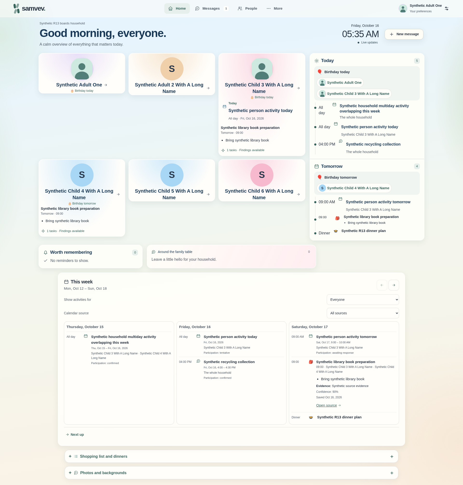
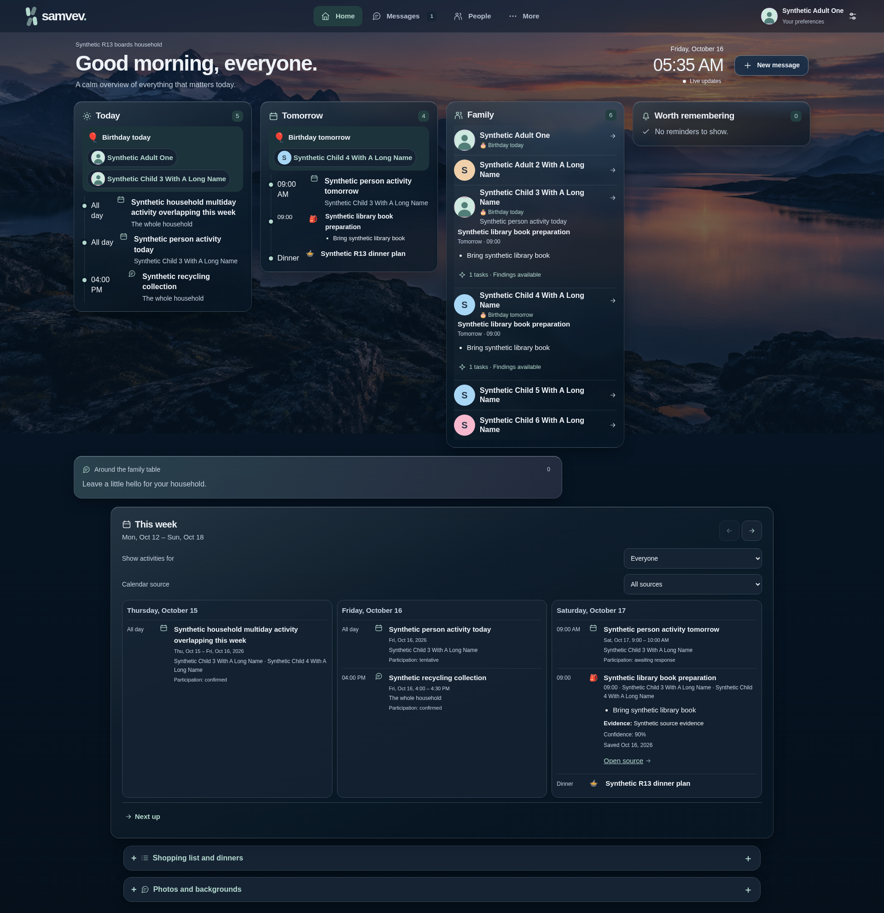
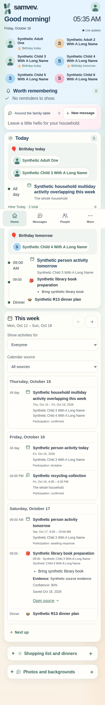
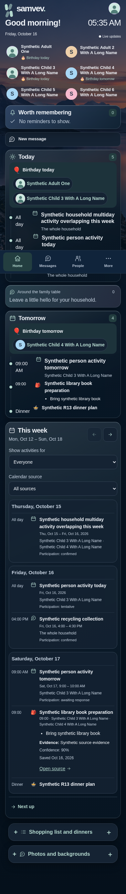
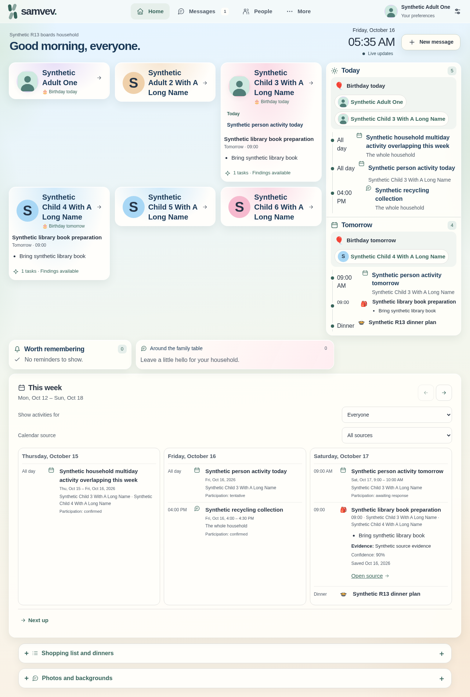
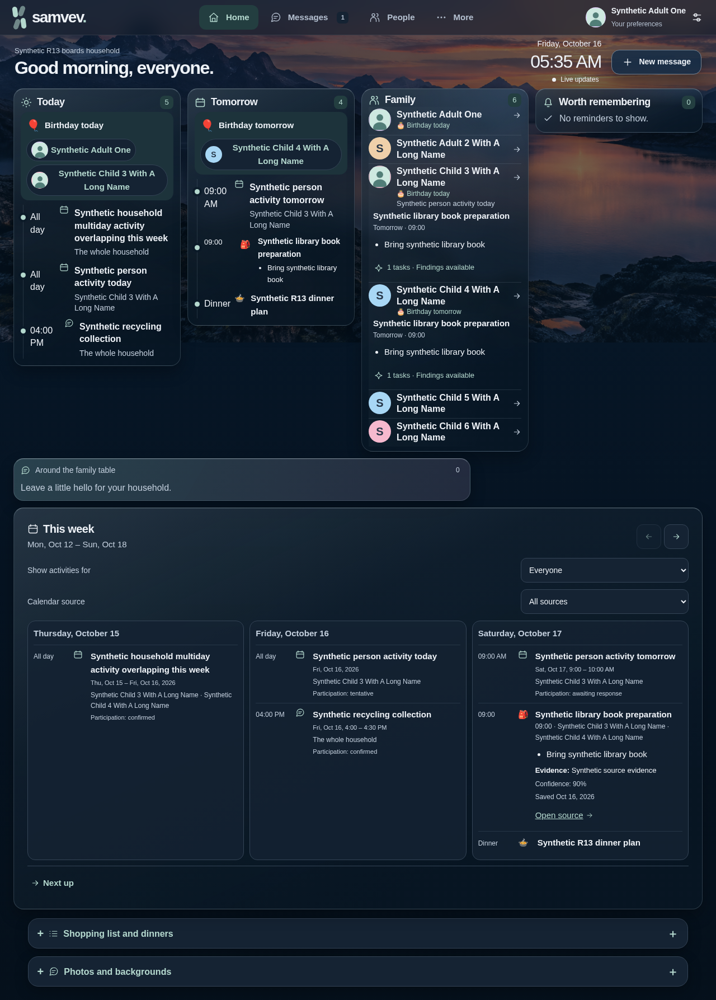
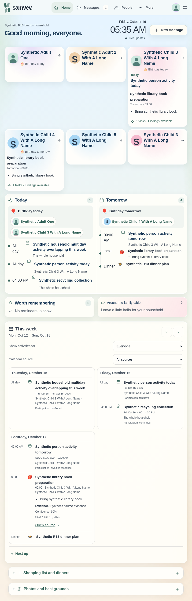

# Round 13 supplemental Home visuals

These seven images are supplemental layout evidence from the earlier six-person synthetic Home fixture. They show desktop, mobile, tablet and Shelly-sized layouts in light and dark themes. The displayed names, messages, calendar entries and household-board contents are fictional test data.

This capture is **noncanonical**. It was taken from a source snapshot based on `bb7255ccc023ef1f474f1c2632fb05e3718f93c1`, with a 14-file uncommitted UI overlay. The snapshot record reports runtime-file equivalence with `943bd63c3a2eb23b938ad339a77fbe0546119ac5` across 256 files. These facts identify the capture snapshot; they do not bind the screenshots to the later integrated source revision or its final canonical 14-image review.

The private review record reports seven screenshots reviewed, browser and lifecycle exits of zero, and 117 unit tests. It also explicitly marks the capture as noncanonical and the public deployment as unchanged R12. The exact image dimensions and SHA-256 digests are in [manifest.json](manifest.json).

Only the seven Home screenshots are included. They do not claim verification of the separate display, boards, Home Assistant, or public-pages surfaces.

| View | Light | Dark |
| --- | --- | --- |
| Desktop, 1920 px viewport |  |  |
| Mobile, 390 px viewport |  |  |
| Shelly, 1280 px viewport |  |  |
| Tablet, 820 px viewport |  | — |
